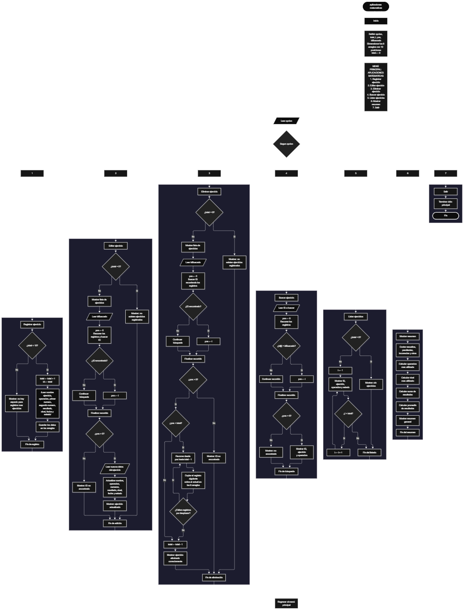

Este proyecto, llamado <b>aplicaciones matematicas</b>, fue desarrollado en <b>java</b> como un ejercicio práctico para fortalecer la lógica de programación mediante la creación de un sistema de gestión de ejercicios matemáticos desde la consola. El programa cuenta con un menú principal de siete opciones que permite <b>registrar, editar, eliminar, buscar, listar y analizar información de los ejercicios registrados</b>. Cada ejercicio almacena datos como el nombre del ejercicio, tipo de operación, primer número, segundo número, resultado, nivel, fecha y estado del ejercicio, utilizando arreglos con una capacidad máxima de <b>10 ejercicios durante la ejecución</b>. Durante su desarrollo se aplicaron conceptos fundamentales de programación, como variables, arreglos, estructuras condicionales, ciclos repetitivos y estructuras de selección, además de procesos para buscar, modificar, eliminar y organizar registros. El programa también incorpora estadísticas relacionadas con los ejercicios matemáticos almacenados. Este proyecto permite poner en práctica los conocimientos adquiridos en Java y sirve como base para desarrollar sistemas de gestión más avanzados utilizando otros lenguajes y tecnologías.

<h2 align="center">⚙️ Funcionamiento del menú principal</h2>

### ➕ Registrar ejercicio

La opción <b>1) registrar ejercicio</b> permite almacenar un nuevo ejercicio matemático dentro del sistema. Antes de realizar el registro, el sistema comprueba que la cantidad de ejercicios almacenados sea menor a <b>10</b>, utilizando la condición <b>total < nombresEjercicios.length</b>. Si existe espacio disponible, la variable <b>total</b> aumenta en uno y el programa solicita el <b>nombre del ejercicio, tipo de operación, primer número, segundo número, resultado, nivel, fecha y estado</b> del ejercicio. Los datos se almacenan en la posición correspondiente de sus respectivos arreglos. Finalmente, muestra el mensaje <b>"Ejercicio registrado correctamente."</b>. Si el sistema alcanza su capacidad máxima, presenta el mensaje <b>"No hay espacio para registrar mas ejercicios."</b>, impidiendo registrar nuevos ejercicios.

### ✏️ Editar ejercicio

La opción <b>2) editar ejercicio</b> permite modificar la información de un ejercicio registrado. Primero, el programa comprueba si existen ejercicios almacenados mediante la variable <b>total</b>. Si no hay registros, muestra el mensaje <b>"No existen ejercicios registrados."</b>. En caso contrario, presenta una lista con el identificador, nombre del ejercicio, tipo de operación, primer número, segundo número, resultado, nivel, fecha y estado de cada ejercicio. Después, solicita el identificador del ejercicio que se desea editar y comprueba que esté dentro del rango permitido mediante la condición <b>idEditar >= 1 y idEditar <= total</b>. Si la selección es válida, solicita nuevamente toda la información del ejercicio y actualiza directamente los valores de los arreglos correspondientes. Finalmente, presenta el mensaje <b>"Ejercicio actualizado correctamente."</b>. Si el identificador seleccionado no corresponde a un ejercicio registrado, informa que el ejercicio seleccionado no existe.

### 🗑️ Eliminar ejercicio

La opción <b>5) eliminar ejercicio</b> permite eliminar un ejercicio registrado mediante su identificador dentro de la lista. Antes de comenzar, el programa comprueba que existan ejercicios almacenados. Si el sistema está vacío, muestra el mensaje <b>"No existen ejercicios registrados."</b>. Si hay registros disponibles, presenta una lista con la información de cada ejercicio. Después, solicita el identificador del ejercicio que se desea eliminar y verifica que la selección esté dentro del rango válido. Si el ejercicio existe, comienza el proceso de eliminación. Para mantener los registros organizados, utiliza un ciclo <b>for</b> controlado por la variable <b>i</b>, que desplaza una posición hacia atrás los datos de los ejercicios posteriores en los arreglos <b>nombresEjercicios, tiposOperaciones, primerosNumeros, segundosNumeros, resultados, niveles, fechas y estados</b>. Posteriormente, disminuye la variable <b>total</b> en uno y muestra el mensaje <b>"Ejercicio eliminado correctamente."</b>. Si el identificador seleccionado no corresponde a un ejercicio registrado, informa que el ejercicio seleccionado no existe.

### 🔎 Buscar ejercicio

La opción <b>4) buscar ejercicio</b> permite localizar un ejercicio mediante su identificador. Primero, el programa comprueba si existen ejercicios registrados. Si el sistema está vacío, muestra el mensaje <b>"No existen ejercicios registrados."</b>. En caso contrario, solicita el identificador del ejercicio que se desea buscar. A continuación, verifica que el valor introducido se encuentre dentro del rango válido mediante la condición <b>idBusqueda >= 1 y idBusqueda <= total</b>. Cuando encuentra una coincidencia, muestra el nombre del ejercicio, tipo de operación, primer número, segundo número, resultado, nivel, fecha y estado correspondiente al registro consultado. Si el identificador introducido no corresponde a ningún ejercicio registrado, presenta el mensaje <b>"ID no encontrada."</b>.

### 📋 Listar ejercicios

La opción <b>3) listar ejercicios</b> permite visualizar todos los ejercicios registrados actualmente en el sistema. Antes de mostrar la información, el programa comprueba si la variable <b>total</b> es igual a cero. Si no existen registros, presenta el mensaje <b>"No existen ejercicios registrados."</b>. Si hay ejercicios disponibles, utiliza un ciclo <b>for</b> para recorrer los arreglos desde la primera posición hasta el número total de ejercicios registrados. Durante el recorrido, muestra el identificador, nombre del ejercicio, tipo de operación, primer número, segundo número, resultado, nivel, fecha y estado de cada ejercicio almacenado. Esta función facilita consultar los registros existentes sin necesidad de buscar cada ejercicio individualmente.

### 📄 Mostrar resumen

La opción <b>6) mostrar resumen</b> permite consultar información estadística relacionada con los ejercicios matemáticos registrados. Primero, el programa comprueba si existen ejercicios almacenados. Si no existen registros, muestra el mensaje <b>"No existen ejercicios registrados."</b>. En caso contrario, calcula la cantidad de ejercicios resueltos, pendientes, incorrectos y pertenecientes a otros estados. También determina la operación matemática más utilizada, el nivel más utilizado, la suma de resultados obtenidos y el promedio de los resultados registrados. Finalmente, presenta toda esta información en forma de resumen general.

### 🚪 Salir del menú principal

La opción <b>7) salir</b> está destinada a finalizar la ejecución del programa y muestra el mensaje <b>"Gracias por utilizar Aplicaciones Matematicas."</b>. El menú principal se encuentra dentro de una estructura repetitiva <b>do ... while</b>, que mantiene el programa en funcionamiento mientras se realizan las operaciones disponibles. La condición final es <b>opcion != 7</b>, por lo que al seleccionar la opción 7 el programa finaliza correctamente.

<h2 align="center">🧠 Temas aplicados en el proyecto</h2>

### 📦 Variables

En este proyecto se utilizan variables para guardar la opción seleccionada en el menú, controlar la cantidad de ejercicios registrados, recorrer los arreglos, seleccionar los ejercicios que se desean editar, eliminar o consultar y almacenar los resultados estadísticos generados durante el resumen. Cada variable cumple una función específica dentro de las operaciones de gestión de ejercicios matemáticos.

🔢 **Opcion:** Almacena la opción seleccionada por el usuario en el menú principal.

📊 **Total:** Almacena la cantidad actual de ejercicios registrados.

🔄 **I:** Funciona como contador en los ciclos <b>for</b> y permite seleccionar la posición de un ejercicio.

🆔 **IdEditar:** Almacena el identificador del ejercicio que se desea modificar.

🔎 **IdBusqueda:** Almacena el identificador utilizado para realizar una búsqueda.

🗑️ **IdEliminar:** Almacena el identificador del ejercicio que se desea eliminar.

📈 **PromedioResultados:** Almacena el promedio calculado de los resultados registrados.

### 🗃️ Arreglos

En este proyecto se utilizan ocho arreglos relacionados con los datos de cada ejercicio matemático. Cada arreglo tiene una capacidad de <b>10 posiciones</b> y utiliza el mismo índice para representar la información correspondiente a un mismo ejercicio. Esta organización permite recorrer, buscar, modificar, mostrar y eliminar los ejercicios de manera ordenada.

📝 **NombresEjercicios:** Almacena los nombres de los ejercicios registrados.

➕ **TiposOperaciones:** Almacena los tipos de operaciones matemáticas.

🔢 **PrimerosNumeros:** Almacena el primer número utilizado en el ejercicio.

🔢 **SegundosNumeros:** Almacena el segundo número utilizado en el ejercicio.

✅ **Resultados:** Almacena los resultados obtenidos.

🎯 **Niveles:** Almacena el nivel de dificultad del ejercicio.

📆 **Fechas:** Almacena las fechas de registro.

📌 **Estados:** Almacena el estado actual de cada ejercicio.

### 🔀 Estructuras condicionales

En este proyecto se utilizan las estructuras <b>if</b> y <b>else</b> para comprobar si el sistema dispone de espacio antes de registrar un ejercicio, verificar si existen registros antes de realizar determinadas operaciones, validar el identificador seleccionado para editar, eliminar o consultar un ejercicio y clasificar los estados utilizados durante el resumen estadístico. Estas condiciones permiten que el programa responda de manera diferente según el estado del sistema y el resultado de cada operación.

### 🔄 Estructuras repetitivas

En este proyecto se utilizan los ciclos <b>for</b> y <b>do ... while</b>. Los ciclos <b>for</b> permiten recorrer los arreglos para mostrar los ejercicios, realizar búsquedas, generar estadísticas y acceder a los registros seleccionados. Durante la eliminación, también se utilizan para desplazar los datos de los ejercicios posteriores una posición hacia atrás. Por otro lado, el ciclo <b>do ... while</b> mantiene activo el menú principal para que el usuario pueda ejecutar diferentes operaciones antes de salir del programa.

### 🎯 Estructura según

El programa evalúa el valor almacenado en la variable <b>opcion</b> y ejecuta el bloque de instrucciones correspondiente. Cada caso representa una operación específica del sistema: <b>registrar, editar, eliminar, buscar, listar, mostrar resumen o salir</b>. También se utiliza el bloque <b>default</b> para mostrar el mensaje <b>"Opcion no valida."</b> cuando el valor introducido no coincide con ninguna de las opciones definidas.

### 🔢 Dimensionamiento de arreglos

El programa utiliza arreglos con una capacidad de <b>10 posiciones</b> para almacenar la información relacionada con los ejercicios matemáticos registrados. La cantidad de posiciones ocupadas se controla mediante la variable <b>total</b>, por lo que las operaciones recorren únicamente los registros comprendidos entre la primera posición y el total actual de ejercicios.

### 🔄 Reorganización de registros

Cuando se selecciona un ejercicio para eliminarlo, el programa utiliza un ciclo <b>for</b> que comienza en la posición seleccionada y llega hasta <b>total - 1</b>. En cada repetición, los datos de la posición siguiente se copian sobre la posición actual en los arreglos <b>nombresEjercicios, tiposOperaciones, primerosNumeros, segundosNumeros, resultados, niveles, fechas y estados</b>. Después, la variable <b>total</b> disminuye en uno. De esta manera, los ejercicios posteriores ocupan las posiciones disponibles sin dejar espacios vacíos entre los registros activos.

<h2 align="center">¿Cómo se implementaron las operaciones crud en el proyecto?</h2>

Las operaciones <b>crud</b> se implementaron mediante las opciones del menú principal, permitiendo administrar los ejercicios registrados. La operación <b>crear</b> corresponde a <b>registrar ejercicio</b>, donde se introducen los datos de un nuevo ejercicio matemático; <b>leer</b> se realiza mediante las opciones <b>buscar ejercicio, listar ejercicios y mostrar resumen</b>; <b>actualizar</b> corresponde a <b>editar ejercicio</b>, donde se modifican los datos de un ejercicio registrado; y <b>eliminar</b> se realiza mediante la opción <b>eliminar ejercicio</b>. Estas operaciones utilizan variables, arreglos, condicionales y ciclos para gestionar la información almacenada temporalmente durante la ejecución del programa.

<h2 align="center">Diagrama de flujo del proyecto</h2>

<h2 align="center">🛡️ Validaciones del programa</h2>

### 📭 No existen ejercicios registrados

Esta validación se utiliza en las opciones de <b>editar, eliminar, buscar, listar y mostrar resumen</b>. El programa comprueba si la variable <b>total</b> es igual a <b>0</b> y, si no existen ejercicios registrados, muestra el mensaje <b>"No existen ejercicios registrados."</b>. Esta comprobación evita continuar con las operaciones que necesitan información almacenada cuando el sistema está vacío.

### ⚠️ Capacidad máxima alcanzada

Esta validación se utiliza durante el registro de nuevos ejercicios para controlar la capacidad máxima de los arreglos. El programa comprueba si <b>total < nombresEjercicios.length</b> antes de permitir agregar un nuevo registro. Si existe espacio disponible, aumenta el contador y solicita los datos del ejercicio. En caso contrario, muestra el mensaje <b>"No hay espacio para registrar mas ejercicios."</b>, impidiendo registrar más ejercicios mientras se mantenga la capacidad máxima.

### ❌ Ejercicio no encontrado

Esta validación se utiliza durante las operaciones de búsqueda, edición y eliminación. El programa verifica que el identificador introducido sea mayor o igual a <b>1</b> y menor o igual al valor de <b>total</b>. Si la selección se encuentra fuera de ese rango, muestra el mensaje <b>"ID no encontrada."</b>.

### 🔢 Selección de ejercicios

El programa utiliza identificadores para seleccionar los ejercicios que se desean editar, eliminar o consultar. Antes de realizar estas operaciones, comprueba que el identificador introducido corresponda a un ejercicio existente dentro del sistema. Esta validación evita acceder a posiciones que no contienen información válida.

### ⚠️ Opción inválida

La estructura <b>switch</b> incluye el bloque <b>default</b>, que muestra el mensaje <b>"Opcion no valida."</b> cuando el usuario introduce un número que no corresponde a ninguna de las opciones definidas en el menú.

<h2 align="center">🎯 Objetivo del proyecto</h2>

El objetivo principal de este proyecto es fortalecer la <b>lógica de programación</b> mediante el desarrollo de un sistema de gestión de ejercicios matemáticos en <b>java</b>. A través de su construcción se busca aplicar los conocimientos adquiridos sobre variables, arreglos, estructuras condicionales, ciclos repetitivos y estructuras de selección, integrándolos para resolver un problema de manera organizada. Además, el proyecto permite comprender cómo registrar, consultar, modificar, eliminar y analizar información en una aplicación de consola, estableciendo una base para desarrollar sistemas de gestión más completos con otros lenguajes y tecnologías.

